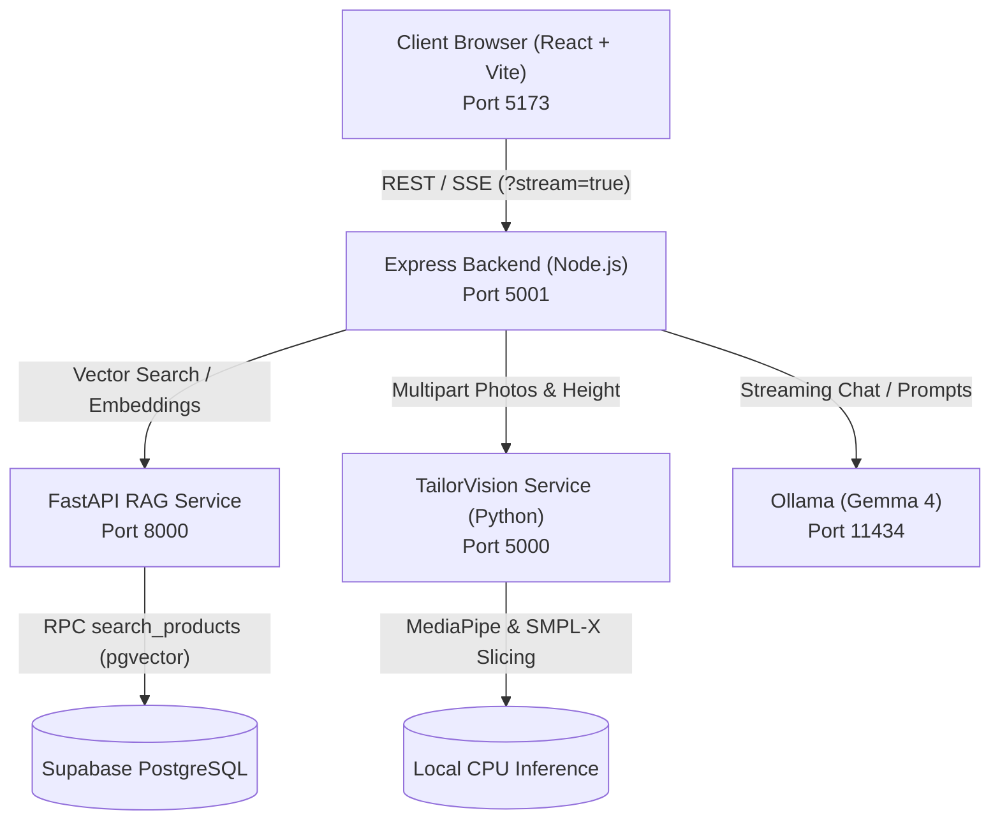

# Fit Cloths — AI-Powered Bespoke Tailoring & Fashion Platform

Fit Cloths is an end-to-end bespoke tailoring and e-commerce application that bridges computer vision anthropometry with an intelligent RAG styling agent. It allows users to capture tailoring-accurate body measurements from just two ordinary photos and receive personalized outfit recommendations tailored directly to their silhouette.

The entire AI pipeline is heavily optimized for consumer hardware, running locally on an 8-core CPU (no dedicated GPU required) with end-to-end latencies under **13 seconds**.

---

## Key Features

- **📸 TailorVision 3D Measurement Engine (`tailorvision`)**:
  - Deterministic computer vision validator checking blur, resolution, upright posture, and framing in **<200ms**.
  - Parametric SMPL-X 3D human body mesh fitting and cross-sectional slicing that computes **16 tailoring circumferences** (chest, waist, hips, inseam, collar, sleeve, etc.).
  - Reuses 2D pose landmarks across stages to eliminate redundant computation.
  - Pre-warmed singleton model caching resident in RAM.

- **👗 GX Styling & RAG Agent (`backend` + `AI`)**:
  - Conversational fashion advisor powered by local **Ollama (`gemma4:e2b`)** and **Supabase `pgvector`** (384-dimensional `all-MiniLM-L6-v2` embeddings).
  - Server-Sent Events (SSE) streaming delivering the **first visible token in ~0.38s**.
  - Smart intent detection: responds warmly to greetings without unwanted product cards, while dynamically rendering matching product cards when styling or catalog suggestions are requested.

- **🛍️ Bespoke E-Commerce Storefront (`frontend`)**:
  - Editorial, neo-brutalist aesthetic with custom typography and micro-interactions.
  - Interactive body measurement dossier with ease allowances (traditional, slim, relaxed fit).
  - Dynamic product catalog, interactive cart management, and streamlined checkout.

---

## Architecture at a Glance



| Service | Port | Technology | Purpose |
| :--- | :---: | :--- | :--- |
| **Frontend** | `5173` | React 18, Vite, Tailwind CSS | Storefront, 3D measurement UI, GX Agent drawer |
| **Backend** | `5001` | Node.js, Express 5 | Gateway, CORS, auth, SSE streaming proxy |
| **TailorVision** | `5000` | Python Flask, PyTorch, MediaPipe, SMPL-X | 3D body mesh fitting & circumference extraction |
| **RAG API** | `8000` | FastAPI, SentenceTransformers | Query embedding & Supabase vector search |
| **Ollama** | `11434` | Ollama runtime (`gemma4:e2b`) | Local conversational LLM with CPU optimization |
| **Database** | Cloud | Supabase PostgreSQL + `pgvector` | Product catalog, categories, and 384-D embeddings |

---

## Quick Start

For detailed step-by-step instructions, environment variable setup, and database schemas, refer to the complete **[SETUP_AND_INTEGRATION_GUIDE.md](./SETUP_AND_INTEGRATION_GUIDE.md)**.

### Summary Commands (5 Terminals):

```powershell
# 1. Start Ollama
ollama run gemma4:e2b

# 2. Start FastAPI RAG Service (Port 8000)
cd AI
.\.venv\Scripts\Activate.ps1
uvicorn rag_api:app --host 0.0.0.0 --port 8000

# 3. Start TailorVision Measurement Service (Port 5000)
cd tailoring-grade_anthropometric_Python_tool
.\.venv\Scripts\Activate.ps1
python app.py

# 4. Start Express Backend (Port 5001)
cd backend
npm run dev

# 5. Start Vite Frontend (Port 5173)
cd frontend
npm run dev
```

Visit **`http://localhost:5173`** in your browser.
