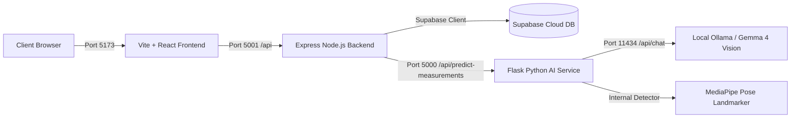

# Fit Cloths — Full-Stack Integration & Developer Guide

This document describes the integrated architecture, service orchestration, environment variables, startup procedures, and testing protocols for the Fit Cloths application.

---

## 1. Architecture Overview



- **Frontend (`frontend/`)**: React 18, Vite 6, Tailwind CSS, Lucide icons. Runs on `http://localhost:5173`.
- **Backend (`backend/`)**: Node.js v24, Express 5. Handles CORS, Supabase database queries, multipart image upload validation, and proxies AI measurement requests to Flask. Runs on `http://localhost:5001`.
- **AI Service (`AI/`)**: Python 3.12 Flask API. Runs on `http://127.0.0.1:5000`. Features:
  - **Gemma Vision Photo Validator (`gemma_validator.py`)**: Connects to local Ollama (`gemma4:e2b`) to verify full body visibility, single subject, and orientation (`front` vs `right`).
  - **Proportion Engine (`model.py`)**: `TailoredBodyModel` utilizing MediaPipe Pose Landmarker and OpenCV silhouette extraction to compute Ramanujan 3D circumference ellipses for 15 body measurements.
- **Database**: Supabase PostgreSQL for product catalogue, categories, and inventory.

---

## 2. Environment Variables & Ports

| Service | Port | Required Env Variables (without secrets) | Config File |
| :--- | :--- | :--- | :--- |
| **Vite Frontend** | `5173` | `VITE_API_BASE_URL` | `frontend/.env` |
| **Express Backend** | `5001` | `PORT`, `FLASK_API_URL`, `SUPABASE_URL`, `SUPABASE_ANON_KEY`, `SUPABASE_SERVICE_KEY` | `backend/.env` |
| **Flask AI Service** | `5000` | `FLASK_PORT`, `FLASK_HOST`, `OLLAMA_URL`, `OLLAMA_MODEL` (optional: `GEMMA_API_KEY`) | `AI/.env` |
| **Ollama Service** | `11434`| (Internal Ollama runtime daemon) | — |

*Note: Express and Flask previously both defaulted to port `5000`. Express was reconfigured to port `5001` to eliminate port collision.*

---

## 3. How to Start All Services on Windows PowerShell

Open separate PowerShell terminals for each service:

### Step 1: Start Ollama (with Gemma 4)
```powershell
ollama run gemma4:e2b
```
*(Verify by visiting `http://localhost:11434/api/tags`)*

### Step 2: Start Python Flask AI Service (TailorVision 3D Fitting Model)
```powershell
cd c:\Users\haide\OneDrive\Documents\Fit-Cloths\tailoring-grade_anthropometric_Python_tool
.\.venv\Scripts\Activate.ps1
python app.py
```
*(Alternatively, to run the legacy MediaPipe engine: `cd c:\Users\haide\OneDrive\Documents\Fit-Cloths\AI` and run `python app.py`)*
*(Verify by visiting `http://127.0.0.1:5000/`)*

### Step 3: Start Express Backend
```powershell
cd c:\Users\haide\OneDrive\Documents\Fit-Cloths\backend
npm start
# or for auto-reload during development:
npm run dev
```
*(Verify by visiting `http://localhost:5001/api/health`)*

### Step 4: Start Vite React Frontend
```powershell
cd c:\Users\haide\OneDrive\Documents\Fit-Cloths\frontend
npm run dev
```
*(Visit `http://localhost:5173` in your browser)*

---

## 4. Endpoints & Complete Request Flow

### A. Connectivity Verification
- `GET http://localhost:5001/api/health` — Checks Express backend health.
- `GET http://localhost:5001/api/measurements/status` — Checks Express -> Flask connectivity.

### B. AI Measurement Prediction Flow
- **Endpoint**: `POST http://localhost:5001/api/measurements/predict`
- **Request Type**: `multipart/form-data`
- **Payload Fields**:
  - `front_image`: Image file (JPEG, PNG, WebP — max 15 MB)
  - `side_image`: Image file (JPEG, PNG, WebP — max 15 MB)
  - `height_cm`: Decimal number between `100` and `250`
  - `gender`: Anatomical prior (`male`, `female`, or `neutral`)
  - `garment_type`: Target garment for ease allowance (default `traditional`)

### C. Response Formats
- **Success (HTTP 200)**:
  ```json
  {
    "success": true,
    "status": "success",
    "validation": { "front": { "accepted": true }, "side": { "accepted": true } },
    "data": {
      "upper_body": { "chest_circumference": 98.4, "waist_circumference": 82.1, ... },
      "lower_body": { "inseam": 78.5, "outseam": 104.2, ... },
      "body_proportions": { "total_height": 178.0, "shoulder_to_crotch_height": 62.4 },
      "tailoring_recommendations": {
        "garment_type": "traditional",
        "chest_with_ease_cm": 104.4,
        "waist_with_ease_cm": 86.1,
        "collar_size_cm": 41.5
      },
      "measurement_quality": {
        "status": "validated_tailoring_grade",
        "overall_quality_score": 0.91,
        "cross_view_consistency": 0.94,
        "scale_method": "known_height",
        "warnings": ["POOR_FIT_CONVERGENCE"],
        "confidence_levels": { "chest_circumference": "HIGH", "waist_circumference": "HIGH" },
        "uncertainties_cm": { "chest_circumference": 0.8, "waist_circumference": 1.1 }
      }
    },
    "notice": "Measurements are estimated using TailorVision 3D fitting and should be verified by a tailor before garment production."
  }
  ```
- **Photo Validation Rejection (HTTP 422)**:
  ```json
  {
    "success": false,
    "status": "error",
    "stage": "photo_validation",
    "message": "Please retake the rejected photo(s).",
    "validation": { ... },
    "retake": {
      "side": {
        "reason": "View is frontal, not right-side.",
        "retake_instruction": "Please retake the photo from the right side."
      }
    }
  }
  ```
- **Service Unavailable (HTTP 503)**:
  Returned if Flask or Ollama is offline.

---

## 5. Common Troubleshooting Steps

1. **Port in use error (`EADDRINUSE: 5000`)**:
   - Flask runs on 5000. Express must run on 5001. Ensure `PORT=5001` in `backend/.env`.
2. **Gemma validation times out or service unavailable (503)**:
   - Ensure Ollama is running (`ollama list` shows `gemma4:e2b`).
   - If Ollama is cold-started, the first request may take 30–60s while the model loads into GPU/RAM.
3. **MediaPipe Segmentation Mask C++ Abort on Windows**:
   - MediaPipe Windows wheels (0.10.x) encounter an internal `Check failed: 1 == ChannelSize() (1 vs. 4)` when `output_segmentation_masks=True`.
   - In `AI/model.py`, `output_segmentation_masks=False` is used, and the body silhouette is computed via OpenCV morphological thresholding, ensuring zero crashes and instant landmark extraction.
4. **Vite Frontend cannot connect to Backend**:
   - Check `frontend/.env` contains `VITE_API_BASE_URL=http://localhost:5001`.
